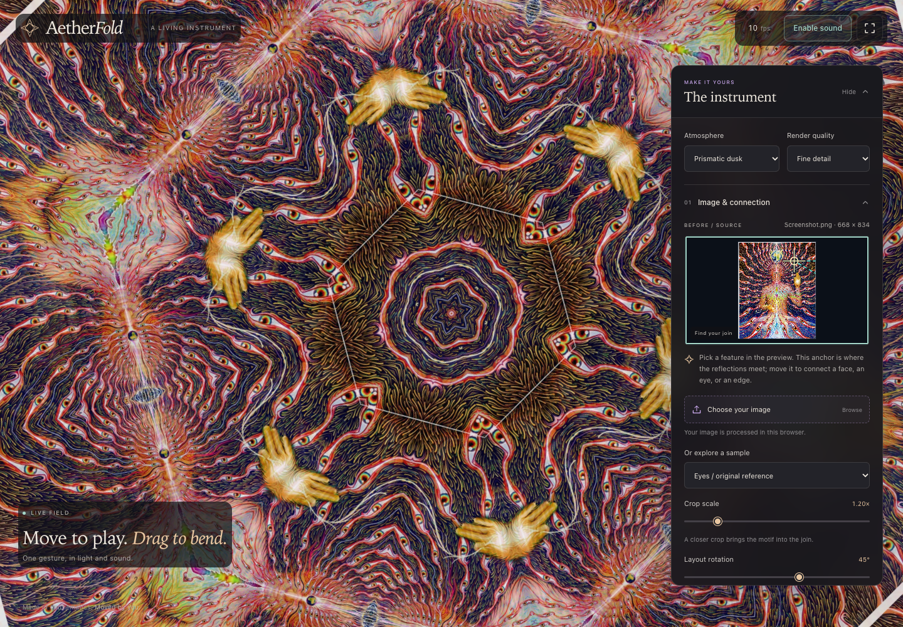
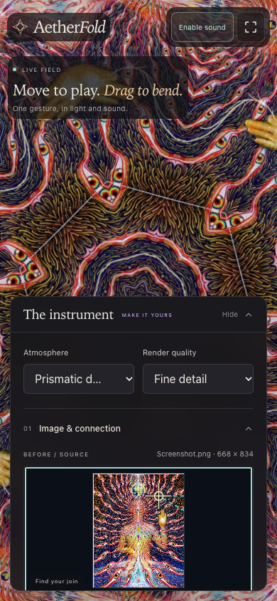

# AetherFold

**Shape the light. Let it sing.**

AetherFold is an interactive visual instrument that turns images into
kaleidoscopic patterns. Move your pointer or hand to warp psychedelic 3D geometry
and shape ambient, microtonal chords through the same gesture.



*Desktop experience: a single source image reflected into a continuous radial
motif, with its connection anchor and composition controls visible.*

## What you can do

- **Compose with images.** Upload a photo or choose a sample, then adjust its
  anchor, crop scale, and layout rotation to choose where reflections meet.
- **Explore five symmetry layouts.** Connected mirror, square lattice, diamond
  lattice, triangle prism, and radial flower.
- **Bend the geometry.** Blend the image into a raymarched gyroid and control
  deformation through pointer movement, touch, or optional hand tracking.
- **Play ambient harmonies.** Explore pentatonic, just-intonation, and microtonal
  tunings with gesture-controlled pitch, filtering, stereo position, and effects.
- **Shape the experience.** Change atmosphere presets, fold count, warp strength,
  render quality, and volume from the live controls.
- **Save a composition.** Export and restore scene JSON containing the settings
  and original source image.

## Mobile preview

<p align="center">
  
</p>

*Touch controls and a collapsible panel keep the artwork and source editor
accessible on smaller screens.*

## Run locally

Use Python 3.11 or newer and a browser with WebGL2 support:

```bash
python3 main.py
```

Open [http://127.0.0.1:8000](http://127.0.0.1:8000), then choose **Enter with
sound** or **Explore silently**. The browser app needs no npm installation,
Python packages, or build step for local use.

The initial composition uses **Vision Study 02** with the **Velvet Void**
atmosphere, triangle symmetry, four folds, a 45° layout rotation, high render
quality, pentatonic tuning, and the saved source anchor from the reference scene.

Uploaded images are processed in your browser. Camera access starts only when
you enable it; tracking runs on your device and downloads its library and model
on demand. Pointer mode and the generated starter work without that download.

## Run with Docker

Start Docker Desktop (or Docker Engine with Compose), then run:

```bash
docker compose up --build -d
```

Open [http://localhost:8080](http://localhost:8080). Docker builds the static
site and serves it with Nginx; Python, Node.js and a GPU are not required on the
server at runtime. Rendering, audio and image processing run in the visitor's
browser. Camera tracking still downloads its model when enabled.

```bash
docker compose ps          # Container and health status
docker compose logs -f app # Server logs
docker compose down       # Stop and remove this app's container
```

To use another local port:

```bash
AETHERFOLD_PORT=8090 docker compose up --build -d
```

Or build and run the image without Compose:

```bash
docker build -t aetherfold:local .
docker run --rm -p 127.0.0.1:8080:8080 --read-only \
  --tmpfs /tmp:size=32m,mode=1777 aetherfold:local
```

The image runs as a non-root user, exposes port `8080`, and provides a
`/healthz` endpoint. The build context includes only the app's required source
and image assets; `.env`, Git history, local environments and screenshots are
excluded.

Compose binds to localhost by default. To make the service reachable on a
server's network interfaces, set `AETHERFOLD_BIND_HOST=0.0.0.0`. For public
hosting, route HTTPS traffic from your hosting platform or reverse proxy to
container port `8080`; camera access requires HTTPS outside localhost.
Building an image does not publish it or deploy the app.

The sample-image requirement in [Build a static site](#build-a-static-site)
also applies to Docker builds from a fresh clone.

## Try your first composition

1. Upload an image or select a sample in **Image & connection**.
2. Pick a feature in the source preview. Drag the anchor to choose the point
   where reflections meet, and adjust **Crop scale** to bring detail into the join.
3. Compare symmetry layouts with **Geometry morph** at zero to see the image's
   original colours without the 3D field.
4. Raise **Geometry morph**, then move and drag across the artwork to bend it.
5. Enable sound and choose a tuning. Move vertically to explore registers and
   horizontally to shape filtering and stereo position.
6. Use **Save scene** to keep the source image and settings together.

Automatic anchor selection uses image detail and background contrast. Manual
placement helps with subjects it cannot identify. Background removal works best
with simple, consistent backgrounds.

## Controls

| Interaction | Effect |
| --- | --- |
| Move across the artwork | Shape geometry and sound |
| Hold and drag / squeeze two touch points | Increase pinch deformation |
| Drag in the source preview | Move the mirror anchor |
| Scroll over the source preview | Adjust crop scale |
| `Space` | Pause or resume motion |
| `↑` / `↓` | Change fold count in lattice and radial layouts |
| `M` | Enable or mute sound |
| `R` | Reset the scene |

Stage shortcuts apply when an editor or form control is not focused. In the
source preview, arrow keys move the anchor and `+` / `-` adjust crop scale.
Camera mode uses palm position and thumb/index pinch, with pointer fallback when
tracking is unavailable.

## How it works

One shared interaction state carries position, movement energy, pinch, and depth
to both engines. WebGL2 renders the reflected image and 3D field; Web Audio
synthesizes the chords and effects. Optional MediaPipe tracking supplies the
same controls from a webcam.

| Component | Source |
| --- | --- |
| Image loading, focal analysis, and anchor editor | [image-source.js](web/image-source.js) |
| Symmetry and raymarched geometry | [renderer.js](web/renderer.js), [shaders.js](web/shaders.js) |
| Pointer, touch, and hand tracking | [input.js](web/input.js) |
| Chords, tuning, and audio effects | [audio.js](web/audio.js) |
| Live interface and integration | [index.html](web/index.html), [styles.css](web/styles.css), [app.js](web/app.js) |
| Presets and scene validation | [state.js](web/state.js) |

## Build a static site

With Node.js installed:

```bash
npm run build
```

The command prints a new `dist/site-*` directory containing the browser app,
its selected sample images, and a `.nojekyll` file. Serve or publish that directory
as a static site. Asset paths support hosting under a subdirectory.

The build expects every sample referenced in `web/state.js`, including the
photos in `images/test_img/`. That folder is currently gitignored; include those
photos or update the sample list before building from a fresh GitHub clone.

## Development checks

When the local development test suite is available:

```bash
npm test
python3 -m unittest discover -s tests -p 'test_*.py'
npm run test:browser
```

The browser check uses headless Chrome and saves the desktop and mobile
screenshots in `artifacts/`. Set `CHROME_PATH` if Chrome is not at the default
macOS location.

The earlier Python rendering experiment is still available separately:

```bash
uv run python test_fold.py images
```

